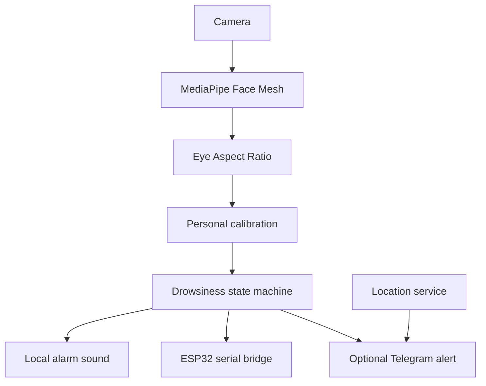
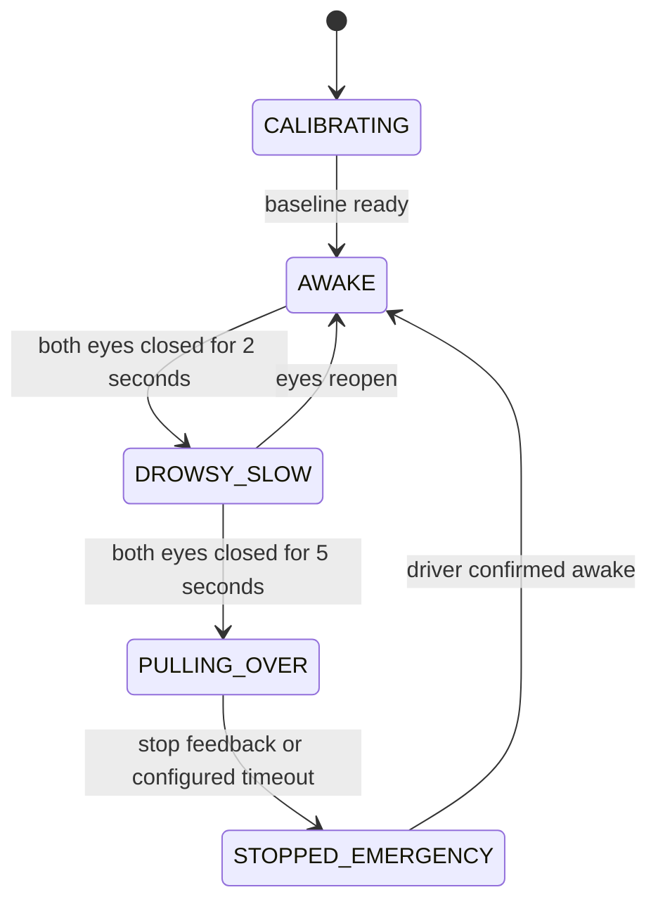

# System Architecture and Workflow

## Architecture

## Response states

At the first threshold the software sends `SLOW_50` and a local alarm sound. At the second it sends `EMERGENCY_PULLOVER`, then can send an optional Telegram alert after stop confirmation. This is a project prototype, not a road-safe autonomous-driving system.

## Eye Aspect Ratio

For six landmarks around an eye, the EAR is the sum of the two vertical distances divided by twice the horizontal distance. The detector compares each eye with the calibrated threshold and can require both eyes to be closed.

## File roles

| Path | Role |
|---|---|
| `main.py` | Application entry point and Telegram test command |
| `vision_engine/detector.py` | Detection and response state machine |
| `vision_engine/calibrator.py` | Personal open-eye baseline |
| `vision_engine/ear_calculator.py` | Landmark geometry |
| `vision_engine/esp32_serial_bridge.py` | Serial bridge and simulation behavior |
| `emergency_alerter/telegram_notifier.py` | Optional Telegram notifications |
| `emergency_alerter/local_audio_alert.py` | Local-only audible alerts |
| `emergency_alerter/location_service.py` | Location resolution for notifications |
| `tests/` | Unit and pipeline tests |

Telegram credentials are read from environment variables. Keep them out of `config.json`, documentation and version control.
