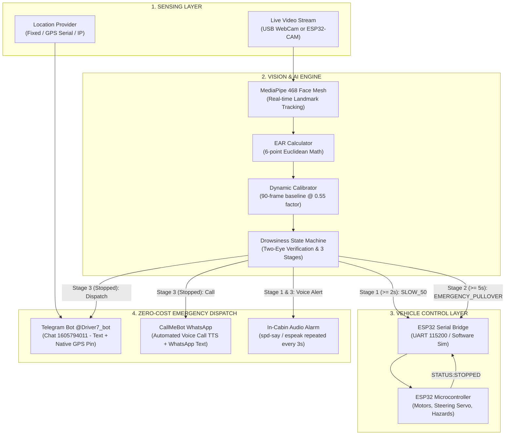
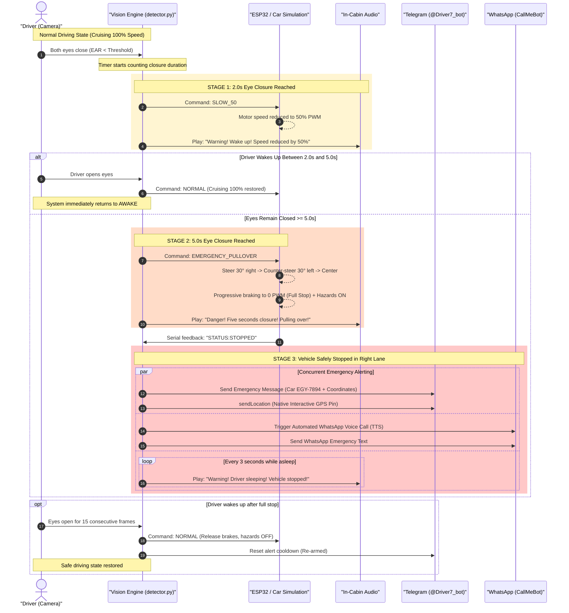
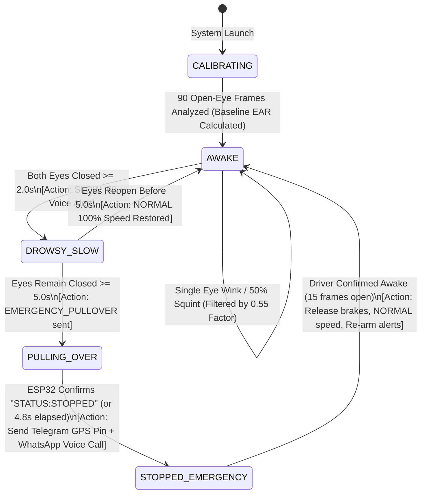

# System Architecture & Workflow Charts: Driver Drowsiness Emergency Brake System

This document provides visual flowcharts, state machine diagrams, sequence diagrams, and mathematical models explaining the entire architecture of the Driver Drowsiness Detection & Autonomous Emergency Response System.

---

## 1. High-Level System Architecture



---

## 2. 3-Stage Emergency Response Sequence Diagram



---

## 3. Finite State Machine (FSM) Diagram



---

## 4. Eye Aspect Ratio (EAR) Mathematical Model

```
       P2          P3
        •──────────•
       /            \
  P1  •              •  P4
  (Outer) \        /   (Inner)
        •──────────•
       P6          P5
```

$$\text{EAR} = \frac{\|P_2 - P_6\| + \|P_3 - P_5\|}{2 \times \|P_1 - P_4\|}$$

### Two-Eye Threshold Logic:
- **Baseline EAR**: Calibrated dynamically per driver ($\approx 0.30 - 0.36$).
- **Threshold**: $\text{Baseline} \times 0.55$ ($\approx 0.17 - 0.20$).
- **Wink & Squint Immunity**:
  $$\text{Is Closed} = (\text{Left EAR} < \text{Threshold}) \land (\text{Right EAR} < \text{Threshold})$$
  - If driver winks one eye: $\text{Left} = 0.08, \text{Right} = 0.35 \implies \text{FALSE}$ (Driver remains `AWAKE`).
  - If driver squints 50%: $\text{EAR} = 0.22 > 0.19 \implies \text{FALSE}$ (Driver remains `AWAKE`).
  - If driver sleeps: $\text{Left} = 0.08, \text{Right} = 0.08 \implies \text{TRUE}$ (Drowsiness timer activates).

---

## 5. File Structure & Responsibilities

| File Path | Primary Function | Interactions |
| :--- | :--- | :--- |
| [main.py](file:///home/jo/eye/main.py) | Application entry point, CLI flags (`--test-call`, `--test-telegram`, `--esp-cam`) | Launches `detector.py`, `callmebot_notifier.py`, `telegram_notifier.py` |
| [detector.py](file:///home/jo/eye/vision_engine/detector.py) | Central vision loop, 3-stage state machine, on-screen HUD overlay | Calls `ear_calculator`, `calibrator`, `esp32_serial_bridge`, `alerters` |
| [ear_calculator.py](file:///home/jo/eye/vision_engine/ear_calculator.py) | 6-point Euclidean landmark math for Left and Right EAR | Consumed by `detector.py` and `test_ear.py` |
| [calibrator.py](file:///home/jo/eye/vision_engine/calibrator.py) | Dynamic open-eye baseline calculation over 90 frames | Sets personal closure threshold using 0.55 multiplier |
| [esp32_serial_bridge.py](file:///home/jo/eye/vision_engine/esp32_serial_bridge.py) | USB UART serial communication at 115200 baud with software simulation | Sends `SLOW_50`, `EMERGENCY_PULLOVER`, `NORMAL`; listens for `STATUS:STOPPED` |
| [telegram_notifier.py](file:///home/jo/eye/emergency_alerter/telegram_notifier.py) | High-priority Telegram Bot API dispatcher (@Driver7_bot) | Dispatches text alert + `sendLocation` interactive map pin |
| [callmebot_notifier.py](file:///home/jo/eye/emergency_alerter/callmebot_notifier.py) | WhatsApp automated voice call (TTS) & in-cabin continuous alarm | Calls CallMeBot API (`/call.php`) & local `spd-say`/`espeak` |
| [location_service.py](file:///home/jo/eye/emergency_alerter/location_service.py) | Multi-source location resolver (Fixed GPS / Serial GPS / IP) | Supplies coordinates (`31.209093, 29.923094`) to alert dispatchers |
| [config.json](file:///home/jo/eye/config.json) | Centralized configuration for timings, car plate, credentials, and modes | Read by all modules on startup |
